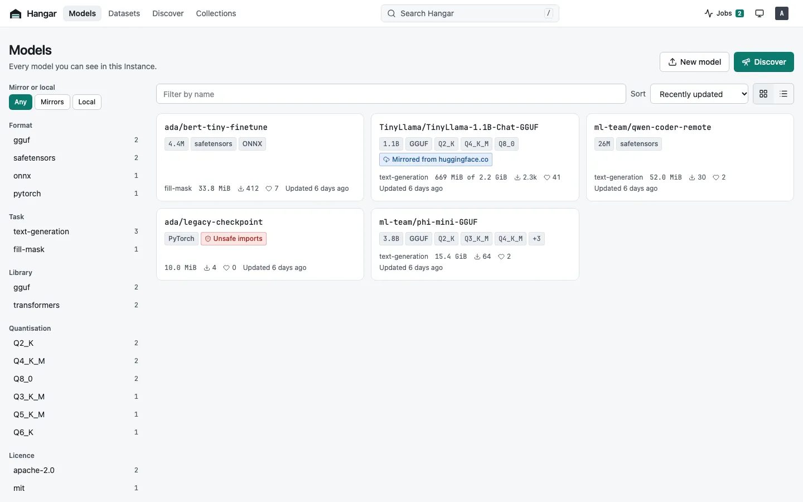
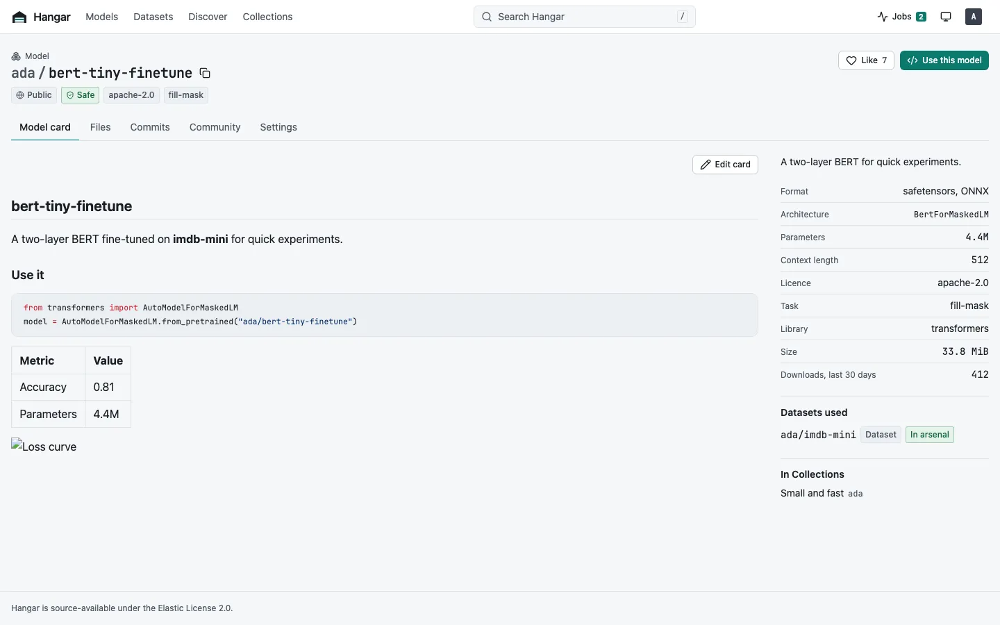
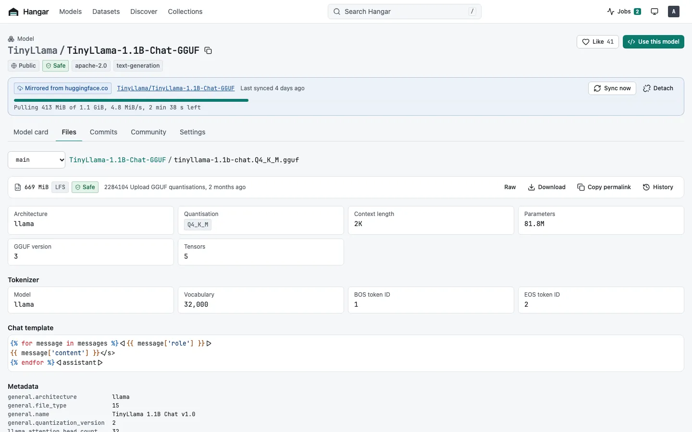
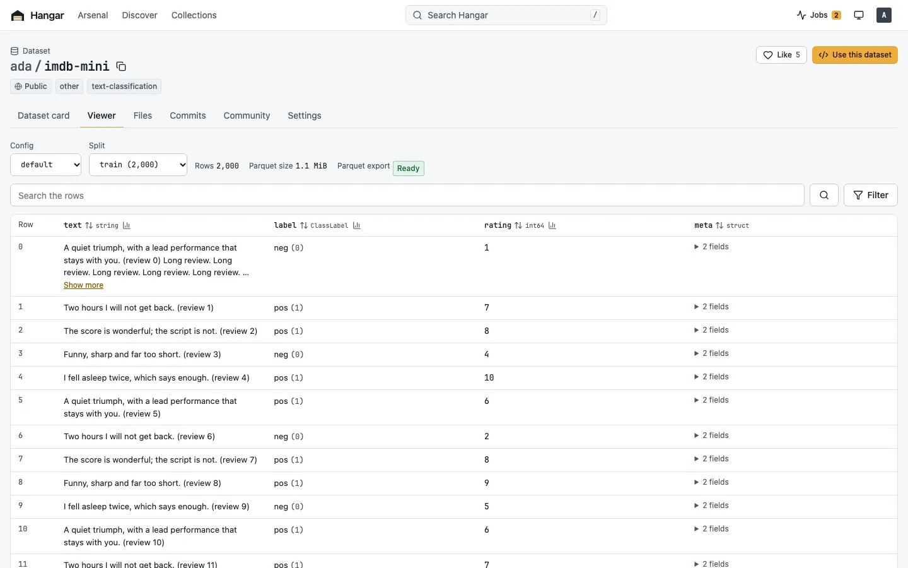

# Hangar

**A self-hosted home for your arsenal of models.**

[](https://github.com/hangar-hub/hangar/releases/latest)
[](https://github.com/hangar-hub/hangar/actions/workflows/ci.yml)
[](LICENSE)
[](https://artifacthub.io/packages/search?repo=hangar)

Hangar is a self-hosted model and dataset hub, compatible with the Hugging Face Hub API, git, Ollama and LM Studio. Use it as a private Hugging Face Hub alternative, a model registry for your own models, or a Hugging Face mirror that also works on an air-gapped network.



Hangar keeps your machine learning models and datasets on your own storage, with full version history, and serves them to the tools you already use:

- **Hugging Face clients**: set `HF_ENDPOINT`, and `huggingface_hub`, the `hf` CLI, `transformers`, `diffusers`, `sentence-transformers`, `datasets` and vLLM work unchanged.
- **git**: `git clone` and `git push`, with git-lfs.
- **Ollama**: `ollama pull hangar.example.com/org/model:Q4_K_M` for any GGUF Repo.
- **LM Studio**: `hangar lmstudio install org/model:Q4_K_M`.
- **Datasets**: `load_dataset`, pandas and Polars over `hf://`, DuckDB over HTTPS, plus a Dataset Viewer in the browser to preview, search, filter and profile rows.

## Why Hangar

- Pull a model or dataset from huggingface.co once, including only the quantisation, Config or Split you want and any code it depends on, then load it from local storage as often as you like.
- Mirrors keep the upstream Repo IDs and Commit SHAs, so code that names `org/model` or pins a Commit works against Hangar unchanged.
- Upload models that exist nowhere else, with `huggingface_hub` or `git push`.
- Feed an air-gapped Instance from another Instance that has internet access.
- Browse everything you have, and everything you could pull, in a web UI with a GGUF viewer and a Dataset Viewer.
- Run one container on a laptop or homelab, or stateless replicas over Postgres and S3-compatible storage, with OIDC sign-in and OpenTelemetry traces, metrics and logs.

Hangar stores and serves files; it doesn't run models. To see how it compares with olah, JFrog Artifactory, Sonatype Nexus, CSGHub, MLflow Model Registry and Hugging Face Enterprise, read [How Hangar compares](https://hangar.page/latest/concepts/comparison/).

| Model card | GGUF viewer | Dataset Viewer |
|---|---|---|
|  |  |  |

To try the web UI without installing anything, open the demo at <https://demo.hangar.page/>. It runs on sample data, and nothing you do there is saved.

## Quickstart

```sh
docker run -d --name hangar -p 8080:8080 -v hangar:/var/lib/hangar \
  -e HANGAR_SERVER_PUBLIC_URL=http://localhost:8080 \
  ghcr.io/hangar-hub/hangar:latest
docker logs hangar   # prints the generated admin password and Instance key once
```

Open <http://localhost:8080>, sign in as `hangar-admin`, and pull `hf-internal-testing/tiny-random-bert` from **Discover**. Create a Token under **Settings**, **Tokens**. Then, with `transformers` and `torch` installed:

```sh
export HF_ENDPOINT=http://localhost:8080 HF_TOKEN=hgr_...
python -c "from transformers import AutoModel; AutoModel.from_pretrained('hf-internal-testing/tiny-random-bert')"
```

If Hangar is useful to you, a star on GitHub helps other people find it.

## Install

| Option | How |
|---|---|
| Container image | `ghcr.io/hangar-hub/hangar` for linux/amd64 and linux/arm64, signed with cosign |
| Docker Compose | Examples for SQLite, Postgres and MinIO, a scaled-out setup and Keycloak in [`deploy/compose`](deploy/compose) |
| Kubernetes | `helm install hangar oci://ghcr.io/hangar-hub/charts/hangar --set publicURL=https://hangar.example.com`, with `publicURL` set to the address clients use; see the [Helm guide](https://hangar.page/latest/get-started/helm/) and [`deploy/helm/hangar`](deploy/helm/hangar) |
| Binary | [Release archives](https://github.com/hangar-hub/hangar/releases) for Linux, macOS and Windows, or `brew install --cask hangar-hub/tap/hangar` |
| From source | `go install github.com/hangar-hub/hangar/cmd/hangar@latest` builds the CLI and server without the web UI |

## Documentation

<https://hangar.page/>: getting started, concepts, guides for every client, operating Hangar, and the API, CLI, configuration and metrics references.

## Get help

See [SUPPORT.md](SUPPORT.md) for where to ask questions and report bugs. Report security problems privately, as [SECURITY.md](SECURITY.md) describes.

## Contributing

See [CONTRIBUTING.md](CONTRIBUTING.md) and the [code of conduct](CODE_OF_CONDUCT.md).

## Licence

Hangar is source-available under the [Elastic License 2.0](LICENSE). You can use, change and self-host it, including inside your company. You can't offer it to others as a hosted or managed service, or remove licence notices. Third-party notices are in [NOTICE](NOTICE).

Hugging Face, Ollama and LM Studio are trademarks of their owners. Hangar is an independent project, not affiliated with or endorsed by them.
